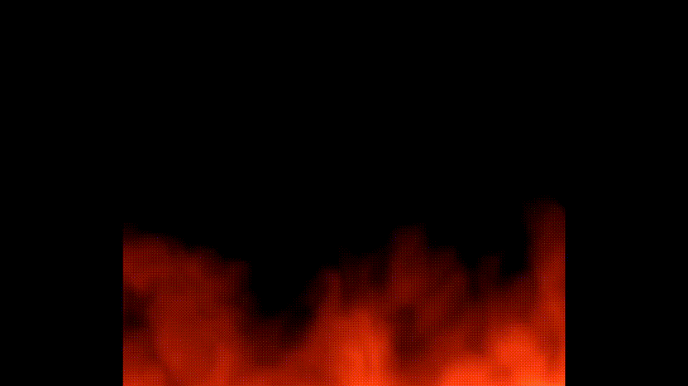
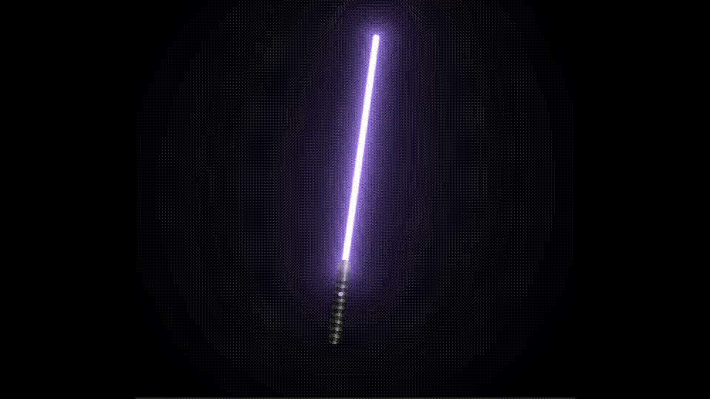
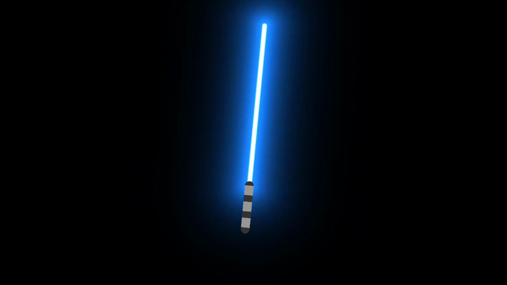

### UNIVERSIDAD DE LAS PALMAS DE GRAN CANARIA
**Grado en Ingeniería Informática — Asignatura: Informática Gráfica**  
*Curso Académico 2026/2027*

---

<h1 style="color: #FFE81F; font-size: 2.2rem; font-weight: bold; letter-spacing: 4px; text-shadow: 0 0 12px rgba(255, 232, 31, 0.6);">
  SHADERS GLSL 2D (TINY CODE) Y RENDERIZADO PROCEDURAL 3D
</h1>

<h3 style="color: #00FFE1; font-size: 1.1rem; letter-spacing: 2px;">
  Desarrollado por: <a href="https://github.com/studies-ulpgc" style="color: #00FFE1; text-decoration: none; font-weight: bold;">Dácil Santana Ortega</a>
</h3>

---

## Índice de Contenidos

1. [Resumen y Motivación de la Práctica](#1-resumen-y-motivaci%C3%B3n-de-la-pr%C3%A1ctica)
2. [Parte I: Shaders 2D en GLSL (*Tiny Code* $\le$ 512 Bytes)](#2-parte-i-shaders-2d-en-glsl-tiny-code--512-bytes)
3. [Parte II: Integración de Shaders 3D en el Sistema Galáctico Star Wars](#3-parte-ii-integraci%C3%B3n-de-shaders-3d-en-el-sistema-gal%C3%A1ctico-star-wars)
4. [Arquitectura del Proyecto y Referencias Académicas](#4-arquitectura-del-proyecto-y-referencias-acad%C3%A9micas)
5. [Bibliografía, Fuentes y Colaboradores](#5-bibliograf%C3%ADa-fuentes-y-colaboradores)

---

## 1. Resumen y Motivación de la Práctica

Este proyecto explora la programación directa de shaders en **OpenGL Shading Language (GLSL)** dividida en dos bloques:

1. **Síntesis Procedural 2D (*Tiny Code* $\le$ 512 bytes):** Tres *fragment shaders* ejecutables en [*The Book of Shaders*](https://editor.thebookofshaders.com/) sin texturas externas. El objetivo es sintetizar fenómenos dinámicos (fuego estilizado, combustión turbulenta con FBM y plasma láser) mediante funciones matemáticas puras respetando un presupuesto estricto de 512 bytes.
2. **Renderizado Procedural 3D en Three.js:** Sustitución de materiales estáticos por materiales programables (`THREE.ShaderMaterial`) dentro de la escena interactiva del **Sistema Galáctico de Star Wars**, combinando deformación geométrica en *Vertex Shaders* e iluminación procedural sin costuras UV en *Fragment Shaders*.

---

## 2. Parte I: Shaders 2D en GLSL (*Tiny Code* $\le$ 512 Bytes)

Todos los *shaders* utilizan los *uniforms* estándar `u_resolution`, `u_time` y `u_mouse`. En el directorio [`shaders_2d/`](./shaders_2d/) se adjuntan tanto las versiones completas comentadas como las versiones minificadas ($\le 512$ bytes).

### 2.1. Resumen Comparativo y Conteo de Bytes

| Nº | Shader | Técnicas Principales | Interactividad (`u_mouse`) | Tamaño *Tiny Code* | Código Fuente |
| :-: | :--- | :--- | :--- | :---: | :--- |
| **01** | **Llama Estilizada** | Campo de distancia 2D, armónicos `sin` y gradiente térmico. | Altura de la llama controlada por el eje Y. | **510 bytes** | [`Comentado`](./shaders_2d/01_llama_comentado.frag) · [`Tiny Code`](./shaders_2d/01_llama_tiny.frag) |
| **02** | **Fuego Realista (FBM)** | *Value Noise* 2D, FBM (4 octavas), *Domain Warping* y paleta potencial. | Foco térmico radial que aviva las llamas alrededor del cursor. | **507 bytes** | [`Comentado`](./shaders_2d/02_fuego_fbm_comentado.frag) · [`Tiny Code`](./shaders_2d/02_fuego_fbm_tiny.frag) |
| **03** | **Sable Láser** | Matriz de rotación `mat2`, SDF de cápsula (`clamp`) y halo inverso. | Rotación del sable (eje X) y cambio de cristal Azul/Rojo (eje Y). | **511 bytes** | [`Comentado`](./shaders_2d/03_sable_comentado.frag) · [`Tiny Code`](./shaders_2d/03_sable_tiny.frag) |

---

### 2.2. Shader 1: Llama Estilizada Interactiva

- **Código fuente:** [`01_llama_comentado.frag`](./shaders_2d/01_llama_comentado.frag) | [`01_llama_tiny.frag`](./shaders_2d/01_llama_tiny.frag) (**510 bytes**)
- **Motivación y desarrollo:** Modelar una llama orgánica ligera mediante ecuaciones analíticas. Se normalizan las coordenadas al rango $[-1, 1]$, se modula el eje horizontal $x$ con dos ondas sinusoidales acopladas a la altura ($\sin(5y - 7t)$ y $\sin(11y - 12t)$) y se mapea el campo de distancia mediante `smoothstep` hacia una paleta de cuerpo negro (rojo $\rightarrow$ naranja $\rightarrow$ amarillo).
- **Fidelidad tras compresión:** La versión *Tiny Code* (510 B) conserva el 100 % de la geometría, animación e interactividad vertical de la versión completa.

  
  &nbsp;&nbsp;
  
   
  <b>Izquierda:</b> Versión comentada &nbsp;|&nbsp; <b>Derecha:</b> Versión <i>Tiny Code</i> (510 bytes)

---

### 2.3. Shader 2: Fuego Realista Procedural (FBM y *Domain Warping*)

- **Código fuente:** [`02_fuego_fbm_comentado.frag`](./shaders_2d/02_fuego_fbm_comentado.frag) | [`02_fuego_fbm_tiny.frag`](./shaders_2d/02_fuego_fbm_tiny.frag) (**507 bytes**)
- **Motivación y desarrollo:** A diferencia del Shader 1 (una llama individual geométrica), este shader genera un frente de combustión turbulento continuo mediante **Fractal Brownian Motion (4 octavas)** sobre *Value Noise* 2D y autodistorsión de dominio (*Domain Warping*). El puntero actúa como un **foco térmico radial** (`smoothstep(0.45, 0.0, length(p - mouse))`) que intensifica el fuego bajo el cursor sin deformar el lienzo.
- **Fidelidad tras compresión:** Al compactar la función FBM y la paleta exponencial (`pow(fuego, 2.2)` y `pow(fuego, 4.5)`), el resultado en **507 bytes** es visualmente indistinguible del código original.

  
  &nbsp;&nbsp;
  
   
  <b>Izquierda:</b> Versión comentada &nbsp;|&nbsp; <b>Derecha:</b> Versión <i>Tiny Code</i> (507 bytes)

---

### 2.4. Shader 3: Sable Láser Interactivo con Matriz de Rotación

- **Código fuente:** [`03_sable_comentado.frag`](./shaders_2d/03_sable_comentado.frag) | [`03_sable_tiny.frag`](./shaders_2d/03_sable_tiny.frag) (**511 bytes**)
- **Motivación y desarrollo:** Conectar la parte 2D con la estética *Star Wars* aplicando transformaciones afines en el espacio del fragmento (`mat2`) y funciones de distancia con signo (SDF). La distancia euclídea a dos segmentos acotados (`clamp`) separa la hoja de plasma de la empuñadura, generando el resplandor con atenuación inversa (`0.032 / d`), parpadeo de alta frecuencia y cambio de cristal Kyber (Jedi/Sith) según la altura del ratón.
- **Fidelidad tras compresión:** Mantiene intactos tanto el núcleo blanco incandescente como el halo cromático y la rotación en **511 bytes**.

  
  &nbsp;&nbsp;
  
   
  <b>Izquierda:</b> Versión comentada &nbsp;|&nbsp; <b>Derecha:</b> Versión <i>Tiny Code</i> (511 bytes)

---

### 2.5. Técnicas de Compresión (*Tiny Code*)

Para mantener los tres archivos `_tiny.frag` por debajo del límite de **512 bytes**:
1. **Limpieza léxica:** Eliminación de comentarios, saltos de línea y espacios prescindibles, agrupando declaraciones (`uniform vec2 u_resolution,u_mouse;`).
2. **Literales abreviados:** Supresión de ceros innecesarios en coma flotante (`.5` en lugar de `0.5`, `1.` en lugar de `1.0`).
3. **Identificadores monoletra e *inlining*:** Variables y funciones de un carácter (`p`, `d`, `f`, `h()`, `n()`, `b()`) e integración directa de expresiones en `main()`.

---

## 3. Parte II: Integración de Shaders 3D en el Sistema Galáctico Star Wars

En [`src/shaders/planetShaders.js`](./src/shaders/planetShaders.js) se han implementado cuatro materiales GLSL personalizados conectados a un *uniform* temporal compartido (`sharedShaderUniforms.u_time`). Todos los shaders planetarios evalúan el ruido FBM de 5 octavas sobre el **vector de posición 3D normalizado (`normalize(position)`)**, eliminando por completo las costuras UV y la distorsión en los polos.

| Astro / Elemento | Demostración Visual | Implementación Técnica en GLSL (Vertex & Fragment Shader) |
| :--- | :---: | :--- |
| **Sol Central** *(Plasma y Corona Fresnel)* |  | • **Vertex Shader:** Pulsación radial suave acoplada a `u_time` sobre la normal de cada vértice. • **Fragment Shader:** Doble pasada de FBM 3D en 5 octavas (*warping* convectivo) combinada con un **efecto Fresnel** (`pow(1.0 - max(dot(n, viewDir), 0.0), 2.2)`) que intensifica la corona solar dorada en los bordes de la esfera. |
| **Planeta Mustafar** *(Domain Warping 3D)* |  | • **Domain Warping 3D:** Desplaza el dominio espacial mediante un campo vectorial tridimensional $\mathbf{q}$ animado con `u_time` para generar ríos de lava fluida sin costuras. • **Iluminación Híbrida:** La corteza volcánica oscura responde a la luz direccional del Sol central (`dot(n, luzDir)`), mientras que el magma actúa como **superficie emisiva** brillante en el hemisferio nocturno, rematada por una atmósfera ígnea Fresnel. |
| **Planeta Hoth** *(Relieve 3D y Normales)* |  | • **Desplazamiento Geométrico:** El *Vertex Shader* deforma la geometría real de la esfera (`SphereGeometry` $64 \times 64$) desplazando los vértices según el relieve FBM. • **Normales por Diferencias Finitas:** El *Fragment Shader* calcula el gradiente 3D $\nabla h$ del terreno glaciar para perturbar la normal por píxel (`nEsculpida`), produciendo sombras escarpadas, brillo especular sobre el hielo y un halo atmosférico cian. |
| **Estrella de la Muerte** *(Escudo Deflector)* |  | • **Renderizado Aditivo:** Esfera envolvente (`AdditiveBlending`, `depthWrite: false`) vinculada a la estación espacial en el Episodio IV. • **Rejilla y Fresnel:** Combina un patrón reticular UV, ondas de escaneo sinusoidales y opacidad dependiente del ángulo de visión para que el escudo sea transparente en el centro y brillante en el contorno. |

---

## 4. Arquitectura del Proyecto y Referencias Académicas

### 4.1. Estructura de Módulos

<pre><b>IG_S9_Shaders/</b>
├── <a href="./shaders_2d/">shaders_2d/</a>                       # Shaders 2D (versiones comentadas y Tiny Code <= 512 B)
│   ├── <a href="./shaders_2d/01_llama_comentado.frag">01_llama_comentado.frag</a> / <a href="./shaders_2d/01_llama_tiny.frag">01_llama_tiny.frag</a>
│   ├── <a href="./shaders_2d/02_fuego_fbm_comentado.frag">02_fuego_fbm_comentado.frag</a> / <a href="./shaders_2d/02_fuego_fbm_tiny.frag">02_fuego_fbm_tiny.frag</a>
│   └── <a href="./shaders_2d/03_sable_comentado.frag">03_sable_comentado.frag</a> / <a href="./shaders_2d/03_sable_tiny.frag">03_sable_tiny.frag</a>
├── <a href="./3D_models/">3D_models/</a>                        # Modelos .glb (Estrella de la Muerte, X-Wing, R2-D2)
├── <a href="./readme_media/">readme_media/</a>                     # Recursos gráficos y GIFs demostrativos
├── <a href="./src/">src/</a>                          # Código fuente de la aplicación
│   ├── <a href="./src/shaders/planetShaders.js">shaders/planetShaders.js</a>      # Shaders 3D GLSL (Sol, Mustafar, Hoth y Escudo)
│   ├── <a href="./src/modules/planetBuilder.js">modules/planetBuilder.js</a>      # Asignación de ShaderMaterial a los astros
│   ├── <a href="./src/modules/deathStar.js">modules/deathStar.js</a>          # Gestión de la estación y escudo deflector
│   └── <a href="./src/main.js">main.js</a>                       # Bucle principal y actualización de u_time
└── <a href="./README.md">README.md</a>                         # Documentación técnica de la práctica
</pre>

### 4.2. Correspondencia con los Scripts de Clase (Semana 9)

| Scripts (`otsedom`) | Concepto de Programación GPU | Aplicación en el Proyecto |
| :--- | :--- | :--- |
| **`script_31` – `script_32`** | Estructura GLSL, *uniforms* (`u_time`, `u_resolution`, `u_mouse`) y *swizzling*. | Base de los 3 shaders 2D en [`shaders_2d/`](./shaders_2d/) y de `sharedShaderUniforms`. |
| **`script_33` – `script_34`** | `THREE.ShaderMaterial` y variables `varying` entre *Vertex* y *Fragment Shader*. | Implementado en [`planetShaders.js`](./src/shaders/planetShaders.js) (`vPos`, `vNormalW`, `vWorldPos`). |
| **`script_35` – `script_36`** | *Shaping functions* (`smoothstep`, `mix`, `clamp`) y patrones procedurales. | Mapeo térmico de llamas, haz del sable láser y rejilla del escudo. |
| **`script_37` – `script_38`** | *Value Noise*, *Fractal Brownian Motion* (FBM) y *Domain Warping*. | Fuego 2D FBM y superficie convectiva del Sol y Mustafar. |
| **`script_39` – `script_40`** | *Vertex displacement*, normales por diferencias finitas e iluminación difusa/especular. | Relieve montañoso e iluminación glaciar en el planeta **Hoth**. |

---

## 5. Bibliografía, Fuentes y Colaboradores

### 5.1. Bibliografía y Referencias Técnicas

1. **The Book of Shaders (Patricio Gonzalez Vivo & Jen Lowe):** [https://thebookofshaders.com/](https://thebookofshaders.com/)
2. **Artículos de Iñigo Quilez (*Domain Warping* y *2D SDFs*):** [https://iquilezles.org/articles/](https://iquilezles.org/articles/)
3. **Documentación Oficial de Three.js (`ShaderMaterial`):** [https://threejs.org/docs/#api/en/materials/ShaderMaterial](https://threejs.org/docs/#api/en/materials/ShaderMaterial)
4. **Repositorios del Profesor Modesto Castrillón (`otsedom`):** [https://github.com/otsedom](https://github.com/otsedom)

### 5.2. Declaración de Asistencia con Herramientas de Inteligencia Artificial

Durante el desarrollo se utilizó **Google Gemini** como asistente técnico para:
- Depuración de expresiones matemáticas en GLSL ES 1.00 / WebGL y resolución de costuras en coordenadas esféricas 3D.
- Optimización sintáctica para ajustar los *fragment shaders* 2D al límite estricto de $\le$ 512 bytes (*Tiny Code*).
- Maquetación y síntesis de la documentación técnica en Markdown.

### 5.3. Autora

| Desarrolladora | Rol | Perfil |
| :--- | :--- | :---: |
| **Dácil Santana Ortega** | Autora Principal y Programación GLSL / Three.js |  |

---

*Proyecto desarrollado para la asignatura de **Informática Gráfica** — Grado en Ingeniería Informática (ULPGC).*  
*Bajo licencia [Creative Commons Reconocimiento - No Comercial 4.0 Internacional (CC BY-NC 4.0)](https://creativecommons.org/licenses/by-nc/4.0/deed.es).*

