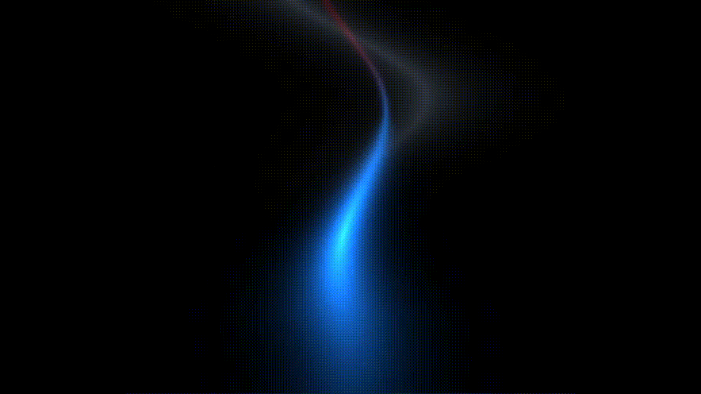
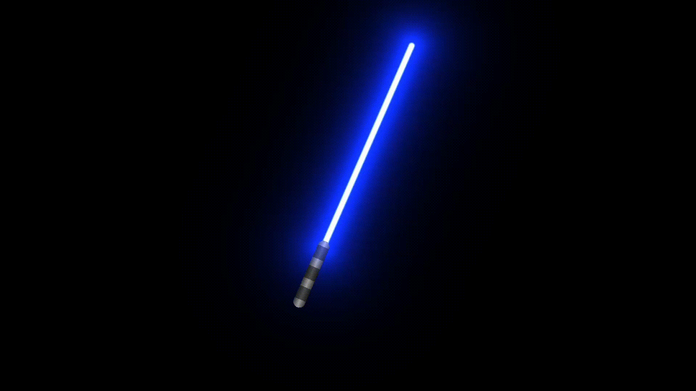

### UNIVERSIDAD DE LAS PALMAS DE GRAN CANARIA
**Grado en Ingeniería Informática — Asignatura: Informática Gráfica**  
*Curso Académico 2026/2027*

---

<h1 style="color: #FFE81F; font-size: 2.2rem; font-weight: bold; letter-spacing: 4px; text-shadow: 0 0 12px rgba(255, 232, 31, 0.6);">
  SHADERS GLSL 2D (TINY CODE) Y RENDERIZADO PROCEDURAL 3D
</h1>

<h3 style="color: #00FFE1; font-size: 1.1rem; letter-spacing: 2px;">
  Desarrollado por: <a href="https://github.com/studies-ulpgc" style="color: #00FFE1; text-decoration: none; font-weight: bold;">Dácil Santana Ortega</a>
</h3>

---

## Índice de Contenidos

1. [Resumen y Motivación de la Práctica](#1-resumen-y-motivaci%C3%B3n-de-la-pr%C3%A1ctica)
2. [Parte I: Shaders 2D en GLSL (*Tiny Code* $\le$ 512 Bytes)](#2-parte-i-shaders-2d-en-glsl-tiny-code--512-bytes)
   - [2.1. Resumen Comparativo y Conteo de Bytes](#21-resumen-comparativo-y-conteo-de-bytes)
   - [2.2. Shader 1: Llama Estilizada Interactiva](#22-shader-1-llama-estilizada-interactiva)
   - [2.3. Shader 2: Fuego Realista Procedural (FBM y *Domain Warping*)](#23-shader-2-fuego-realista-procedural-fbm-y-domain-warping)
   - [2.4. Shader 3: Sable Láser (Interactivo y Versión Autónoma)](#24-shader-3-sable-l%C3%A1ser-interactivo-y-versi%C3%B3n-aut%C3%B3noma)
   - [2.5. Técnicas de Compresión (*Tiny Code*)](#25-t%C3%A9cnicas-de-compresi%C3%B3n-tiny-code)
3. [Parte II: Integración de Shaders 3D en el Sistema Galáctico Star Wars](#3-parte-ii-integraci%C3%B3n-de-shaders-3d-en-el-sistema-gal%C3%A1ctico-star-wars)
4. [Arquitectura del Proyecto y Referencias Académicas](#4-arquitectura-del-proyecto-y-referencias-acad%C3%A9micas)
5. [Bibliografía, Fuentes y Colaboradores](#5-bibliograf%C3%ADa-fuentes-y-colaboradores)

---

## 1. Resumen y Motivación de la Práctica

En esta práctica se trabaja la programación de shaders en **OpenGL Shading Language (GLSL)** dividida en dos partes:

1. **Shaders 2D (*Tiny Code* $\le$ 512 bytes):** Creación de efectos visuales animados en [*The Book of Shaders*](https://editor.thebookofshaders.com/) usando únicamente fórmulas matemáticas (sin imágenes ni texturas externas) y comprimiendo el código por debajo de los 512 bytes.
2. **Shaders 3D en el Sistema Galáctico Star Wars:** Sustitución de los materiales estáticos de la escena 3D anterior por materiales programados en GLSL (`THREE.ShaderMaterial`) para dar movimiento real a la lava de Mustafar, al plasma del Sol, al relieve helado de Hoth y al escudo de la Estrella de la Muerte.

- **Repositorio del Proyecto en GitHub:** [studies-ulpgc/IG_S9-10](https://github.com/studies-ulpgc/IG_S9-10)
- **Entorno CodeSandbox del Proyecto:** [Probar Proyecto en Sandbox](https://codesandbox.io/p/sandbox/github/studies-ulpgc/IG_S9-10)

---

## 2. Parte I: Shaders 2D en GLSL (*Tiny Code* $\le$ 512 Bytes)

Todos los *shaders* 2D están pensados para ejecutarse en el editor web de **The Book of Shaders**. En la carpeta [`shaders_2d/`](./shaders_2d/) se incluyen tanto las versiones completas comentadas como las versiones reducidas ($\le 512$ bytes).

### 2.1. Resumen Comparativo y Conteo de Bytes

| Nº | Shader | Efecto Visual | Interactividad | Tamaño *Tiny Code* | Archivos Fuente |
| :-: | :--- | :--- | :--- | :---: | :--- |
| **01** | **Llama Estilizada** | Llama individual ondulante con gradiente térmico. | El eje Y del ratón regula la altura de la llama. | **510 bytes** | [`Comentado`](./shaders_2d/01_llama_comentado.frag) · [`Tiny Code`](./shaders_2d/01_llama_tiny.frag) |
| **02** | **Fuego Realista (FBM)** | Frente de fuego turbulento con ruido fractal de 4 octavas. | El cursor actúa como un foco de calor que aviva las llamas. | **507 bytes** | [`Comentado`](./shaders_2d/02_fuego_fbm_comentado.frag) · [`Tiny Code`](./shaders_2d/02_fuego_fbm_tiny.frag) |
| **03** | **Sable Láser (v1)** | Sable láser con empuñadura metálica, rotación y resplandor. | Rotación con eje X y cambio de color (Azul/Rojo) con eje Y. | **511 bytes** | [`Comentado`](./shaders_2d/03_sable_comentado.frag) · [`Tiny Code`](./shaders_2d/03_sable_tiny.frag) |
| **03b** | **Sable Láser (v2 Autónoma)** | Variante *Tiny Code* sin ratón con ciclo automático de colores Kyber. | Automática con `u_time` (Azul $\rightarrow$ Verde $\rightarrow$ Morado $\rightarrow$ Rojo). | **510 bytes** | [`Tiny Code v2`](./shaders_2d/03_sable_tiny_version2.frag) |

---

### 2.2. Shader 1: Llama Estilizada Interactiva

#### Versión Completa Comentada ([`01_llama_comentado.frag`](./shaders_2d/01_llama_comentado.frag))
Modela la silueta de una llama orgánica mediante ondas sinusoidales combinadas con un campo de distancia 2D. A medida que la coordenada vertical sube, la llama se estrecha y oscila lateralmente, aplicando un degradado de color desde rojo oscuro hasta amarillo brillante en el núcleo. Al mover el ratón en vertical (`u_mouse.y`), la llama crece o se encoge.

  
   
  <a href="./readme_media/shaders2d/01_llama_full.gif">Ver o descargar GIF original</a> · <a href="./shaders_2d/01_llama_comentado.frag">Ver código GLSL comentado</a>

#### Versión *Tiny Code* — 510 bytes ([`01_llama_tiny.frag`](./shaders_2d/01_llama_tiny.frag))
Al comprimir el código eliminando comentarios, espacios y variables intermedias, se consigue exactamente la misma forma, movimiento e interacción con el ratón dentro del límite de 512 bytes.

  
   
  <a href="./readme_media/shaders2d/01_llama_tiny.gif">Ver o descargar GIF original</a> · <a href="./shaders_2d/01_llama_tiny.frag">Ver código Tiny Code (510 B)</a>

---

### 2.3. Shader 2: Fuego Realista Procedural (FBM y *Domain Warping*)

#### Versión Completa Comentada ([`02_fuego_fbm_comentado.frag`](./shaders_2d/02_fuego_fbm_comentado.frag))
A diferencia del primer shader, aquí se genera un muro de fuego turbulento continuo mediante ruido fractal (*Fractal Brownian Motion* de 4 octavas) que se distorsiona a sí mismo para imitar el movimiento real de las llamas al ascender. Además, el cursor actúa como un foco de calor radial que aviva el fuego allí donde se sitúe el puntero.

  
   
  <a href="./readme_media/shaders2d/02_fuego_full.gif">Ver o descargar GIF original</a> · <a href="./shaders_2d/02_fuego_fbm_comentado.frag">Ver código GLSL comentado</a>

#### Versión *Tiny Code* — 507 bytes ([`02_fuego_fbm_tiny.frag`](./shaders_2d/02_fuego_fbm_tiny.frag))
Compactando el bucle de ruido fractal y la paleta de colores exponencial en nombres de función de una sola letra, el efecto completo y el foco térmico del cursor se mantienen intactos en 507 bytes.

  
   
  <a href="./readme_media/shaders2d/02_fuego_tiny.gif">Ver o descargar GIF original</a> · <a href="./shaders_2d/02_fuego_fbm_tiny.frag">Ver código Tiny Code (507 B)</a>

---

### 2.4. Shader 3: Sable Láser (Interactivo y Versión Autónoma)

#### Versión Completa Comentada ([`03_sable_comentado.frag`](./shaders_2d/03_sable_comentado.frag))
Conecta la parte 2D con la temática *Star Wars* del proyecto 3D. Utiliza una matriz de rotación 2D y funciones de distancia a segmentos para dibujar por separado la hoja luminosa y la empuñadura metálica con relieve cilíndrico y anillas. Al mover el ratón cambia tanto la inclinación como el color del cristal Kyber (de Azul Jedi a Rojo Sith).

  
   
  <a href="./readme_media/shaders2d/03_sable_full.gif">Ver o descargar GIF original</a> · <a href="./shaders_2d/03_sable_comentado.frag">Ver código GLSL comentado</a>

#### Versión *Tiny Code* Interactiva — 511 bytes ([`03_sable_tiny.frag`](./shaders_2d/03_sable_tiny.frag))
Primera versión comprimida que mantiene el control por ratón (`u_mouse`), el balanceo pendular, la empuñadura con bandas y el doble resplandor exponencial de la hoja en 511 bytes.

  
   
  <a href="./readme_media/shaders2d/03_sable_tiny.gif">Ver o descargar GIF original</a> · <a href="./shaders_2d/03_sable_tiny.frag">Ver código Tiny Code (511 B)</a>

#### Versión *Tiny Code* Autónoma (Sin Ratón) — 510 bytes ([`03_sable_tiny_version2.frag`](./shaders_2d/03_sable_tiny_version2.frag))
Como ampliación solicitada tras la revisión en clase, se creó esta segunda versión *Tiny Code* prescindiendo de `u_mouse`. Los bytes ahorrados al quitar el ratón se aprovecharon para que el sable cambie de color automáticamente con `u_time` (recorriendo azul, verde, morado y rojo) y para añadir reflejos del láser sobre el metal de la empuñadura.

  
   
  <a href="./readme_media/shaders2d/03_sable_tiny_version2.gif">Ver o descargar GIF original</a> · <a href="./shaders_2d/03_sable_tiny_version2.frag">Ver código Tiny Code v2 (510 B)</a>

---

### 2.5. Técnicas de Compresión (*Tiny Code*)

Para lograr que todos los archivos `_tiny` ocupen **$\le$ 512 bytes**:
1. **Limpieza de formato:** Eliminación de comentarios, saltos de línea y espacios innecesarios.
2. **Números abreviados:** Uso de `.5` en lugar de `0.5` o `1.` en lugar de `1.0`.
3. **Nombres cortos y macros:** Variables de una sola letra (`p`, `d`, `c`) y uso de `#define` (como `#define L length(...)`) para evitar repetir expresiones largas.

---

## 3. Parte II: Integración de Shaders 3D en el Sistema Galáctico Star Wars

En [`src/shaders/planetShaders.js`](./src/shaders/planetShaders.js) se han creado cuatro materiales GLSL personalizados conectados al tiempo de la escena (`sharedShaderUniforms.u_time`). Todos calculan el ruido directamente sobre la superficie 3D de la esfera (`normalize(position)`), evitando costuras verticales o deformaciones en los polos.

| Astro / Elemento | Demostración Visual | Funcionamiento del Shader (Vertex & Fragment) |
| :--- | :---: | :--- |
| **Sol Central** *(Plasma y Corona)* |  <a href="./readme_media/shaders3d/01_sol_shader.gif">Ver o descargar GIF</a> | • **Vertex Shader:** Produce una pulsación suave en el radio de la estrella. • **Fragment Shader:** Simula la ebullición del plasma solar mediante ruido fractal 3D y añade un brillo dorado intenso en los bordes (*efecto Fresnel*). |
| **Planeta Mustafar** *(Lava en Movimiento)* |  <a href="./readme_media/shaders3d/02_mustafar_shader.gif">Ver o descargar GIF</a> | • **Fluidez del Magma:** Distorsiona las coordenadas 3D con el tiempo (*Domain Warping*) para que los ríos de lava fluyan de forma continua. • **Luz y Emisión:** La roca oscura recibe luz del Sol central, mientras que las grietas de lava brillan con luz propia incluso en la cara nocturna. |
| **Planeta Hoth** *(Relieve y Hielo)* |  <a href="./readme_media/shaders3d/03_hoth_shader.gif">Ver o descargar GIF</a> | • **Deformación 3D:** El *Vertex Shader* levanta las montañas y valles reales sobre la malla de la esfera. • **Sombreado Glaciar:** El *Fragment Shader* recalcula la inclinación del terreno por píxel para proyectar sombras en las cordilleras y destellos sobre el hielo. |
| **Estrella de la Muerte** *(Escudo Deflector)* |  <a href="./readme_media/shaders3d/04_escudo_shader.gif">Ver o descargar GIF</a> | • **Transparencia Aditiva:** Esfera semitransparente que envuelve la estación espacial. • **Rejilla Energética:** Combina una cuadrícula luminosa, ondas de escaneo descendentes y transparencia en el centro para resaltar el contorno del campo de fuerza. |

---

## 4. Arquitectura del Proyecto y Referencias Académicas

### 4.1. Estructura de Módulos

<pre><b>IG_S9-10/</b>
├── <a href="./shaders_2d/">shaders_2d/</a>                            # Shaders 2D (comentados y Tiny Code <= 512 B)
│   ├── <a href="./shaders_2d/01_llama_comentado.frag">01_llama_comentado.frag</a> / <a href="./shaders_2d/01_llama_tiny.frag">01_llama_tiny.frag</a>
│   ├── <a href="./shaders_2d/02_fuego_fbm_comentado.frag">02_fuego_fbm_comentado.frag</a> / <a href="./shaders_2d/02_fuego_fbm_tiny.frag">02_fuego_fbm_tiny.frag</a>
│   └── <a href="./shaders_2d/03_sable_comentado.frag">03_sable_comentado.frag</a> / <a href="./shaders_2d/03_sable_tiny.frag">03_sable_tiny.frag</a> / <a href="./shaders_2d/03_sable_tiny_version2.frag">03_sable_tiny_version2.frag</a>
├── <a href="./3D_models/">3D_models/</a>                             # Modelos .glb (Estrella de la Muerte, X-Wing, R2-D2)
├── <a href="./readme_media/">readme_media/</a>                          # Recursos gráficos y GIFs demostrativos
├── <a href="./src/">src/</a>                               # Código fuente de la aplicación
│   ├── <a href="./src/shaders/planetShaders.js">shaders/planetShaders.js</a>           # Shaders 3D GLSL (Sol, Mustafar, Hoth y Escudo)
│   ├── <a href="./src/modules/planetBuilder.js">modules/planetBuilder.js</a>           # Asignación de ShaderMaterial a los astros
│   ├── <a href="./src/modules/deathStar.js">modules/deathStar.js</a>               # Gestión de la estación y escudo deflector
│   └── <a href="./src/main.js">main.js</a>                            # Bucle principal y actualización de u_time
└── <a href="./README.md">README.md</a>                              # Documentación de la práctica
</pre>

### 4.2. Correspondencia con los Scripts de Clase (Semana 9)

- **Entorno CodeSandbox del Proyecto:** [Probar Proyecto en Sandbox](https://codesandbox.io/p/sandbox/github/studies-ulpgc/IG_S9-10)
- **CodeSandbox Semana 9 ([`otsedom`](https://github.com/otsedom)):** [ig-s9-j9q2h4](https://codesandbox.io/p/sandbox/ig-s9-j9q2h4)

| Scripts ([`otsedom`](https://github.com/otsedom)) | Concepto Base | Aplicación en el Proyecto |
| :--- | :--- | :--- |
| **[`script_31` – `script_32`](https://codesandbox.io/p/sandbox/ig-s9-j9q2h4)** | Estructura GLSL, *uniforms* (`u_time`, `u_resolution`, `u_mouse`) y manejo de vectores. | Base de los shaders 2D en [`shaders_2d/`](./shaders_2d/) y de `sharedShaderUniforms`. |
| **[`script_33` – `script_34`](https://codesandbox.io/p/sandbox/ig-s9-j9q2h4)** | `THREE.ShaderMaterial` y paso de datos `varying` entre *Vertex* y *Fragment Shader*. | Implementado en [`planetShaders.js`](./src/shaders/planetShaders.js) (`vPos`, `vNormalW`, `vWorldPos`). |
| **[`script_35` – `script_36`](https://codesandbox.io/p/sandbox/ig-s9-j9q2h4)** | Funciones de suavizado (`smoothstep`, `mix`, `clamp`) y patrones geométricos. | Degradados de llamas, haz del sable láser y rejilla del escudo deflector. |
| **[`script_37` – `script_38`](https://codesandbox.io/p/sandbox/ig-s9-j9q2h4)** | Ruido procedural (*Value Noise*), FBM y distorsión de dominio. | Fuego 2D FBM y superficie fluida del Sol y Mustafar. |
| **[`script_39` – `script_40`](https://codesandbox.io/p/sandbox/ig-s9-j9q2h4)** | Deformación de vértices, cálculo de normales e iluminación difusa/especular. | Relieve montañoso e iluminación glaciar en el planeta **Hoth**. |

---

## 5. Bibliografía, Fuentes y Colaboradores

### 5.1. Bibliografía y Referencias Técnicas

1. **The Book of Shaders (Patricio Gonzalez Vivo & Jen Lowe):** [https://thebookofshaders.com/](https://thebookofshaders.com/)
2. **Artículos de Iñigo Quilez (*Domain Warping* y *2D SDFs*):** [https://iquilezles.org/articles/](https://iquilezles.org/articles/)
3. **Documentación Oficial de Three.js (`ShaderMaterial`):** [https://threejs.org/docs/#api/en/materials/ShaderMaterial](https://threejs.org/docs/#api/en/materials/ShaderMaterial)
4. **Repositorios y Sandbox del Profesor Modesto Castrillón ([`otsedom`](https://github.com/otsedom)):**
   - GitHub: [https://github.com/otsedom](https://github.com/otsedom)
   - CodeSandbox Semana 9: [ig-s9-j9q2h4](https://codesandbox.io/p/sandbox/ig-s9-j9q2h4)

### 5.2. Declaración de Asistencia con Herramientas de Inteligencia Artificial

Se detallan ejemplos del uso de modelos de IA (**Google Gemini**) como asistente de soporte técnico durante la práctica:

- **Desarrollo de shaders 2D (*Tiny Code*) y shaders planetarios 3D en GLSL:** [Consulta sobre shaders GLSL y optimización de bytes](<!-- PEGA AQUÍ EL ENLACE DE TU CONVERSACIÓN DE GEMINI -->)
- **Asistencia técnica:** Depuración de expresiones matemáticas en WebGL/GLSL, resolución de costuras en esferas 3D y maquetación de la documentación.

### 5.3. Autora

| Desarrolladora | Rol | Perfil |
| :--- | :--- | :---: |
| **Dácil Santana Ortega** | Autora Principal y Programación GLSL / Three.js |  |

---

*Proyecto desarrollado para la asignatura de **Informática Gráfica** — Grado en Ingeniería Informática (ULPGC).*  
*Bajo licencia [Creative Commons Reconocimiento - No Comercial 4.0 Internacional (CC BY-NC 4.0)](https://creativecommons.org/licenses/by-nc/4.0/deed.es).*

